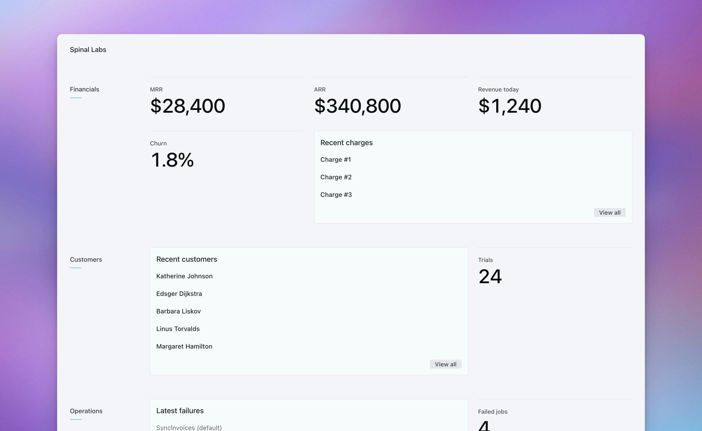

# Bord

A Rails engine that puts a dashboard at `/bord`. Define metrics, lists, categories and pages in `config/bord/`. Every widget runs your own code: ActiveRecord queries, Stripe calls, Good Job stats, Action Mailbox records.



**Sponsored By [Rails Designer](https://railsdesigner.com/)**

<a href="https://railsdesigner.com/" target="_blank">
  <picture>
    <source media="(prefers-color-scheme: dark)" srcset="https://raw.githubusercontent.com/Rails-Designer/bord/HEAD/.github/logo-dark.svg">
    <source media="(prefers-color-scheme: light)" srcset="https://raw.githubusercontent.com/Rails-Designer/board/HEAD/.github/logo-light.svg">
    
  </picture>
</a>

## Getting started

```bash
bundle add bord
bin/rails generate bord:install
```

The installer creates `config/bord/dashboard.rb` and mounts the engine at `/bord`. Bord loads every file under `config/bord/**/*.rb` automatically.

```ruby
# config/bord/dashboard.rb
Bord.draw do
  title "Spinal Labs"

  category :financials, label: "Financials", position: 1 do
    metric :mrr, label: "MRR", icon: :"dollar-sign", value: -> { Current.account.mrr.format }
    list :recent_users, label: "Recent users", items: -> { User.order(created_at: :desc).limit(5) }
  end
end
```

Values and items are lambdas, evaluated per request. List items are model instances, so Bord renders each entry with `to_bord` (see Lists). Add more categories and widgets the same way.

## Metrics

```ruby
metric :users, label: "Users", value: -> { User.count }
```

| Option | Description |
|--------|-------------|
| `label` | Card title, defaults to the humanized id |
| `value` | Scalar or lambda evaluated per request |
| `href` | Makes the value a link |
| `position` | Ordering within the category |
| `actions` | Widget-level actions |
| `if` / `unless` | Conditional visibility |

## Lists

```ruby
list :recent_users,
  label: "Recent users",
  items: -> { User.order(created_at: :desc).limit(5).map { |user| {label: user.email, href: "/admin/users/#{user.id}"} } }
```

Each item is a hash with `label`, optional `href` and `actions`. You can also pass model instances and map them with `to_bord`:

```ruby
class User < ApplicationRecord
  def to_bord
    {title: full_name, description: email, href: admin_user_path(self)}
  end
end

list :recent_users,
  label: "Recent users",
  items: -> { User.order(created_at: :desc).limit(5) }
```

Without `to_bord`, the title falls back to `ModelName #id`. The id comes from `to_gid` or `to_param`. The link comes from the host polymorphic route.

## Categories

```ruby
category :operations, label: "Operations", position: 2 do
  metric :failed_jobs, label: "Failed jobs", value: -> { FailedJob.count }
end
```

Categories group widgets and accept `position` and `if`/`unless`. Widgets outside any category appear below the categories.

## Actions

Two kinds:

```ruby
# Navigation
{label: "View", href: "/admin/users"}

# Server-side action
{label: "Refund", action: {record: charge.to_gid.to_s, method: :refund, customer_id: charge.id}}
```

Bord locates the record by GlobalID, calls `method` with the remaining parameters and refreshes the widget. Add `confirm:` to ask before submitting. Submitted actions must match the actions you declared. Anything else returns 404.

A list with per-item actions and a widget-level action:

```ruby
list :recent_charges,
  label: "Recent charges",
  items: -> {
    Current.account.charges.recent.limit(3).map do |charge|
      {
        label: charge.label,
        href: "/charges/#{charge.id}",
        actions: [
          {
            label: "Refund",
            confirm: "Refund this charge?",
            action: {record: charge.to_gid.to_s, method: :refund, customer_id: charge.id}
          }
        ]
      }
    end
  },
  actions: [{label: "View all", href: "/admin/charges"}]
```

Use `variant:` to style actions: `:primary`, `:danger` or `:text`.

## Pages

```ruby
# config/bord/users.rb
Bord.page :users,
  label: "Users",
  description: "All users",
  records: -> {
    User.order(created_at: :desc).map do |user|
      {
        title: user.email,
        description: "Joined #{user.created_at.to_date}",
        actions: [{label: "View", href: "/admin/users/#{user.id}"}]
      }
    end
  },
  record: ->(id) {
    user = User.find(id)

    {
      title: user.email,
      description: "Customer since #{user.created_at.to_date}",
      fields: [{label: "Email", value: user.email}, {label: "Plan", value: user.plan}],
      actions: [{label: "Edit", href: "/admin/users/#{user.id}/edit"}]
    }
  }
```

Routes:

- `/bord/pages/:page_id`: record list
- `/bord/pages/:page_id/records/:record_id`: record detail

`record` is optional. Without it, the detail route returns 404.

Link to a page from a widget with `bord.page_path(:users)` inside a lambda or a string path.

## Presets

```bash
bin/rails generate bord:presets
```

The generator lists the bundled presets: Solid Queue, GoodJob, Stripe, Devise, Sidekiq, Active Storage, Action Mailbox and User. Pick the ones you want and the generator appends their code to `config/bord/presets.rb`.

Other gems can ship presets too. A preset is a JSON file at `bord/presets/<name>.json` with `name`, `description`, an optional `note` and `code` lines. Presets from gems show up in the same selection list.

## Access

In production, `/bord` returns 404 until you set an authenticated `parent_controller`. Development and test work out of the box. Bord has one authorization gate: the host's `parent_controller`. Anyone with dashboard access can run every declared action. Submitted actions must match the actions you declared. Anything else returns 404.

## Customization

```ruby
# config/initializers/bord.rb
Bord.configure do |configuration|
  configuration.parent_controller = "Admin::BaseController"
  configuration.brand_hue = 250
end
```

`title` is set inside `Bord.draw`.

## License

MIT
